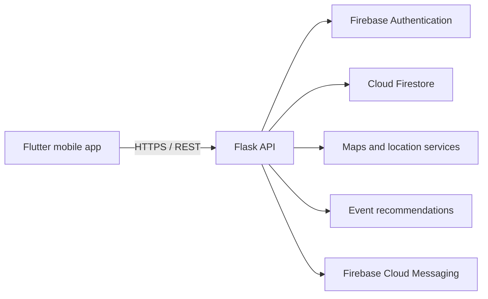

<div align="center">

# 🏆 PlayersZWZ

### Find your players. Create a game. Get moving.

**A university Final Year Project exploring personalized sports matchmaking and nearby event discovery.**

[](https://github.com/pvrplxd/PlayersZWZ)
[](https://flutter.dev)
[](#-what-is-in-this-repository)

</div>

---

## 👋 Welcome

PlayersZWZ is designed to help people find nearby sports games and players based on their interests and location. The idea is to make organizing a match easier: discover an event, join or create a game, and find an arena.

> **What this repository currently contains:** project documentation, an interactive Flutter UI prototype, and a Flutter GPS-tracking proof of concept. These demos support the project; they are not yet the complete production app and backend.

## 🎯 The product idea

PlayersZWZ aims to let players:

- Set up a profile and choose the sports they enjoy.
- Discover nearby events that match their interests.
- Create a game or ask to join one.
- Find and request an arena booking.
- Receive event updates and build a history of games and ratings.

The longer-term design also explores recommendations, notifications, and player trust features. These are **product goals**, not a claim that every feature is already implemented in the demo apps.

## 📦 What is in this repository?

| Folder | What you will find |
| --- | --- |
| [`docs/proposal/`](docs/proposal/) | Initial project proposal and proposal presentation |
| [`docs/phase-01/`](docs/phase-01/) | Phase 1 project report |
| [`docs/phase-02/`](docs/phase-02/) | Phase 2 RS Documentation, presentation, and UI design images |
| [`prototypes/ui-prototype/`](prototypes/ui-prototype/) | Click-through Flutter UI prototype |
| [`prototypes/gps-tracker/`](prototypes/gps-tracker/) | Flutter proof of concept for live GPS tracking |
| [`docs/phase-02/Software-Design-Documentation.docx`](docs/phase-02/Software-Design-Documentation.docx) | Software design project report |

The folder is currently named `app-tests` because these apps were created to demonstrate and test ideas. They are **demo/prototype apps**, not an automated test suite.

## 🗺️ Product architecture

The design documents describe this planned system. The production app and backend are not included in the current repository snapshot.



## 🚀 Run the Flutter demos

You need the [Flutter SDK](https://docs.flutter.dev/get-started/install) and a configured Android emulator, iOS simulator, or connected device.

### UI prototype

```bash
git clone https://github.com/pvrplxd/PlayersZWZ.git
cd PlayersZWZ/fyp-i/phase-02/app-tests/frontend_prototype
flutter pub get
flutter run
```

### GPS-tracking proof of concept

From the repository root, open a separate terminal and run:

```bash
cd fyp-i/phase-02/app-tests/gps_tracker
flutter pub get
flutter run
```

The GPS demo may require location permission and its configured tracking service to be available. Follow the instructions in that app or ask the project team if setup is missing.

## 📚 Project documents

- [Phase 1 RS Documentation](docs/phase-01/RS-Documentation-01.pdf)
- [Phase 2 RS Documentation](docs/phase-02/RS-Documentation-02.pdf)
- [Phase 2 presentation](docs/phase-02/phase-02-presentation.pdf)
- [UI prototype images](docs/phase-02/ui-designs/)
- [Initial proposal](docs/proposal/idea-proposal.pdf)
- [Proposal presentation](docs/proposal/idea-proposal-presentation.pdf)
- [Software design project report](docs/phase-02/Software-Design-Documentation.docx)

## 🧑‍🤝‍🧑 Team

**Group:** S26CS024 · University of Central Punjab

| Team member | Project focus |
| --- | --- |
| Waleed Abid | Mobile architecture, backend integration, and coordination |
| Afaq Ul Islam | Frontend, maps, and UI flows |
| Hassan Ahmed | Recommendations, testing, documentation, and QA |

**Product Owner:** Mr. Asif Farooq

## 🔄 How we track development

Jira is used to plan project work. When implementing a Jira story, include its key in the Git branch, commit message, and pull request title so the code can be connected to the right work item.

Example for [SCRUM-18](https://afaqaamir01.atlassian.net/browse/SCRUM-18):

- Branch: `SCRUM-18-connect-flutter-api`
- Commit: `SCRUM-18 Connect Flutter screens to APIs`
- Pull request: `SCRUM-18 Connect Flutter screens to backend APIs`

## 🔐 Configuration and secrets

Never commit passwords, API keys, signing files, or real environment files. Use your own local configuration for services that require credentials. The repository's `.gitignore` excludes common environment and Firebase configuration files.

---

<div align="center">

**Built as a Final Year Project at the University of Central Punjab.**

</div>
