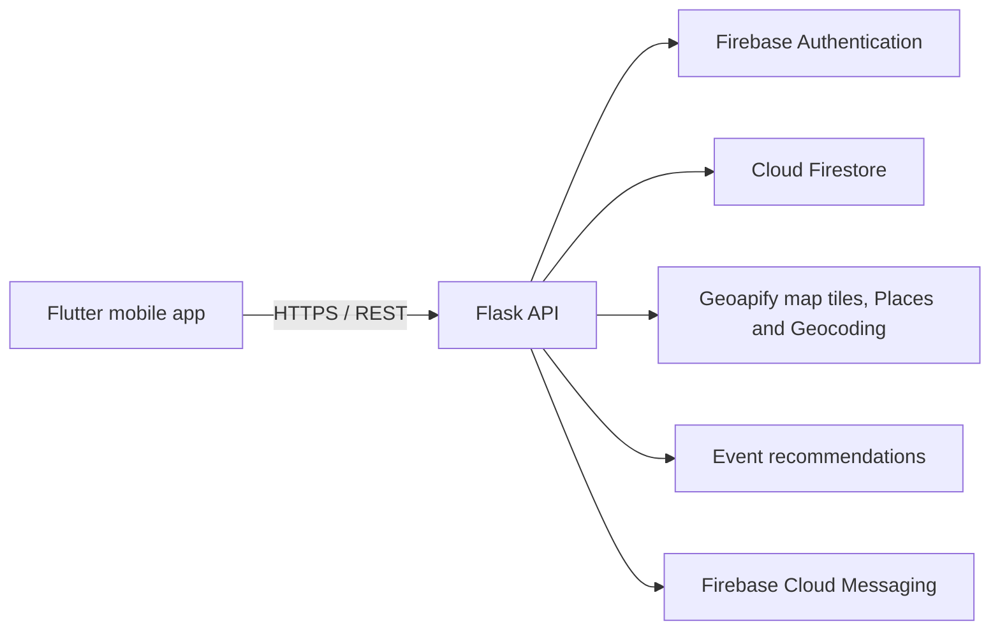

<div align="center">

# 🏆 PlayersZWZ

### Find your players. Create a game. Get moving.

**A university Final Year Project for personalized sports matchmaking and nearby event discovery.**

[](https://github.com/pvrplxd/PlayersZWZ)
[](https://flutter.dev)
[](https://vercel.com)

</div>

---

## 👋 Welcome

PlayersZWZ is designed to help people find nearby sports games and players based on their interests and location. The idea is to make organizing a match easier: discover an event, join or create a game, and find an arena.

> **What this repository contains:** the PlayersZWZ Flutter mobile app, Flask API, and supporting Flutter prototypes.

## 🎯 The product idea

PlayersZWZ aims to let players:

- Set up a profile and choose the sports they enjoy.
- Discover nearby events that match their interests.
- Create a game or ask to join one.
- Find and request an arena booking.
- Receive event updates and build a history of games and ratings.

The longer-term design also explores recommendations, notifications, and player trust features. These are **product goals**, not a claim that every feature is already implemented in the demo apps.

## 📦 What is in this repository?

| Folder | What you will find |
| --- | --- |
| [`apps/mobile/`](apps/mobile/) | PlayersZWZ Flutter mobile app |
| [`services/api/`](services/api/) | Flask API deployed on Vercel |
| [`prototypes/gps_tracker/`](prototypes/gps_tracker/) | Flutter proof of concept for live GPS tracking |
| [`prototypes/ui_prototype/`](prototypes/ui_prototype/) | Click-through Flutter UI prototype |

The two folders under `prototypes/` are demonstration apps: one validates live GPS tracking, and the other shows the planned user interface. They are not an automated test suite.
## 🗺️ Product architecture

> **Map provider update — 22 October 2026:** We replaced Google Maps Platform with Geoapify because Google Maps billing/card setup was not a fit for this FYP budget. Geoapify's Free plan is subject to daily credits, request limits, and required map/data-source attribution; see the [current pricing](https://www.geoapify.com/pricing/) and [pricing details](https://www.geoapify.com/pricing-details/) before release.

The mobile app communicates with the deployed API over HTTPS. Firebase provides identity and Firestore access; Geoapify provides map tiles and geocoding.



## 🧪 Explore the Flutter prototypes

You need the [Flutter SDK](https://docs.flutter.dev/get-started/install) and a configured Android emulator, iOS simulator, or connected device.

### UI prototype

```bash
git clone https://github.com/pvrplxd/PlayersZWZ.git
cd PlayersZWZ/prototypes/ui_prototype
flutter pub get
flutter run
```

### GPS-tracking proof of concept

From the repository root, open a separate terminal and run:

```bash
cd prototypes/gps_tracker
flutter pub get
flutter run
```

The GPS demo may require location permission and its configured tracking service to be available. Follow the instructions in that app or ask the project team if setup is missing.

## 🛠️ Run the PlayersZWZ mobile app

The production Flutter application is in [`apps/mobile/`](apps/mobile/). It connects to the deployed PlayersZWZ API by default, so no local environment file or backend setup is required for ordinary mobile development.

### Prerequisites

- [Flutter SDK](https://docs.flutter.dev/get-started/install) on the stable channel.
- Android Studio with the Android SDK, platform tools, and a connected Android phone or emulator.
- Access to the PlayersZWZ Firebase project to obtain the platform configuration files.
- Your Android debug SHA-1 and SHA-256 fingerprints registered in Firebase before testing Google Sign-In.

### One-time Firebase files

Download the Firebase configuration files from the PlayersZWZ Firebase project and place them locally at:

```text
apps/mobile/android/app/google-services.json
apps/mobile/ios/Runner/GoogleService-Info.plist
```

These files are intentionally ignored by Git. Never commit or share them.

### Run on Android

```bash
git clone https://github.com/pvrplxd/PlayersZWZ.git
cd PlayersZWZ/apps/mobile
flutter pub get
flutter devices
flutter run
```

Select your Android phone if Flutter asks. Google Sign-In, account setup, and the map require an internet connection to the deployed Firebase, Vercel, and Geoapify services.

### Build a testing APK

```bash
cd apps/mobile
flutter build apk --release
```

The APK is created at:

```text
build/app/outputs/flutter-apk/app-release.apk
```

Use this APK for direct tester installation. Do not commit APK files to this repository; publish tested builds as GitHub Release assets instead.

## 🧑‍🤝‍🧑 Team

**Group:** S26CS024 · University of Central Punjab

| Team member | Project focus |
| --- | --- |
| Waleed Abid | Mobile architecture, backend integration, and coordination |
| Afaq Ul Islam | Frontend, maps, and UI flows |
| Hassan Ahmed | Recommendations, testing, documentation, and QA |

**Product Owner:** Mr. Asif Farooq

## 🔄 How we track development

Jira is used to plan project work. When implementing a Jira story, include its key in the Git branch, commit message, and pull request title so the code can be connected to the right work item.

Example for [SCRUM-18](https://afaqaamir01.atlassian.net/browse/SCRUM-18):

- Branch: `SCRUM-18-connect-flutter-api`
- Commit: `SCRUM-18 Connect Flutter screens to APIs`
- Pull request: `SCRUM-18 Connect Flutter screens to backend APIs`

## 🔐 Configuration and secrets

Never commit passwords, API keys, signing files, or real environment files. Use your own local configuration for services that require credentials. The repository's `.gitignore` excludes common environment and Firebase configuration files.

---

<div align="center">

**Built as a Final Year Project at the University of Central Punjab.**

</div>
